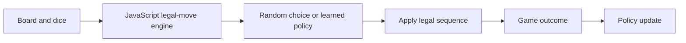

# Plakoto — rules engine and learning opponent

A browser implementation of the Plakoto backgammon variant, with a random opponent and an optional policy trained through self-play.


## Algorithmic focus

The JavaScript engine enumerates legal move sequences, including pinning, bearing off and mother-piece outcomes. A Python policy scores legal choices using hand-built state/action/transition features, samples through a softmax distribution and updates weights from game outcomes. The model is a linear policy, not a deep neural network.



## Play

Open `index.html` in a browser and choose random mode. This mode needs no Python server.

For the learning opponent, run from the repository root:

```bash
python ai_server.py
```

Then open `index.html` and choose **RL model**. The current implementation uses Python's standard library. Its policy is saved to `models/policy.json`; `PLAKOTO_MODEL_PATH` can override that location. The tracked `policy.pt` is not the current JSON policy format.

## Self-play

Requires Node.js and Python 3. Start the rule-engine service:

```bash
node env_server.js
```

In another terminal:

```bash
python ml/train_policy.py --episodes 100 --seed 7
```

Avoid training and playing against the same policy file simultaneously, since both processes can save updates.

## Tests

```bash
node tests/engine.test.js
node tests/ui-smoke.test.js
```

## Code guide and limitations

- `js/engine.js`: rules and legal sequences.
- `ml/policy_model.py`: feature extraction, action selection and learning.
- `ml/train_policy.py`: self-play driver.
- `ai_server.py`: interface between the browser and policy.
- `env_server.js`: rule-engine API for training.

This is an experimental game-learning implementation. No comparison against expert play or statistically evaluated playing-strength claim is included. Tests cover selected rule cases and a simulated interface smoke check, not every reachable game state.
